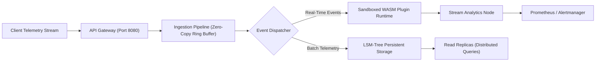

# Example Generated Documentation Output

> **This is a complete, production-grade showcase of technical documentation generated by VisualMark Studio.**  
> It illustrates the rich combination of Shields.io badges, Mermaid architecture diagrams, feature comparison tables, REST API specifications, and All-Contributors grids produced across VisualMark Studio's 11 visual workspaces.

---

# ApexEngine

<p align="center">
  <a href="https://github.com/apex-engine/core"></a>
  <a href="LICENSE"></a>
  <a href="https://rust-lang.org"></a>
  <a href="https://webassembly.org"></a>
  <a href="https://github.com/apex-engine/core/actions"></a>
</p>

<p align="center">
  <b>High-throughput, distributed real-time telemetry processing engine written in Rust with WebAssembly plugins.</b>
</p>

---

## 🏗️ System Architecture



---

## ⚡ Feature Comparison Matrix

| Feature | Legacy Pipeline | ApexEngine |
| :--- | :---: | :---: |
| **Throughput** | 45k events/sec | **1.2M events/sec** |
| **P99 Latency** | 120 ms | **< 1.8 ms** |
| **Memory Footprint** | 2.4 GB Heap | **140 MB Resident** |
| **Extensibility** | Recompilation required | **Dynamic WASM Plugins** |
| **Zero-Copy Serialization** | ❌ No | ✅ FlatBuffers / Cap'n Proto |

---

## 🌐 REST API Specification

### Submit Telemetry Payload

`POST /api/v1/telemetry/events`

#### Request Parameters
| Parameter | Type | In | Description |
| :--- | :--- | :--- | :--- |
| `Authorization` | `string` | Header | Bearer token (`Bearer <api_key>`) |
| `stream_id` | `uuid` | Query | Target stream identifier |

#### Request Body
```json
{
  "device_id": "sensor-node-west-04",
  "timestamp": 1728777600,
  "metrics": {
    "temperature_celsius": 24.8,
    "vibration_rms": 0.042,
    "battery_pct": 98.4
  }
}
```

#### Responses
- `200 OK` — Telemetry ingested successfully into ring buffer.
- `400 Bad Request` — Schema validation failed.
- `429 Too Many Requests` — Ingestion rate limit exceeded.

```bash
curl -X POST "https://telemetry.apexengine.io/api/v1/telemetry/events?stream_id=550e8400-e29b-41d4-a716-446655440000" \
  -H "Authorization: Bearer sec_live_9a8b7c6d5e" \
  -H "Content-Type: application/json" \
  -d '{"device_id":"sensor-04","metrics":{"temperature_celsius":24.8}}'
```

---

## 🚀 Quick Start

### Installation

```bash
# Clone the repository
git clone https://github.com/apex-engine/core.git
cd core

# Build in release mode
cargo build --release
```

### Running the Engine

```bash
./target/release/apex-engine --config config/production.toml
```

---

## 👥 Contributors

This project follows the **[All-Contributors](https://github.com/all-contributors/all-contributors)** specification:

| [<br /><sub><b>Alex Rivera</b></sub>](https://github.com/arivera)<br />💻 📖 🚧 | [<br /><sub><b>Devin Vance</b></sub>](https://github.com/dvance)<br />💻 🎨 🐛 | [<br /><sub><b>Priya Sharma</b></sub>](https://github.com/psharma)<br />📖 💡 🧪 |
| :---: | :---: | :---: |

---

## 📄 License

Distributed under the **MIT License**. See [`LICENSE`](LICENSE) for details.
