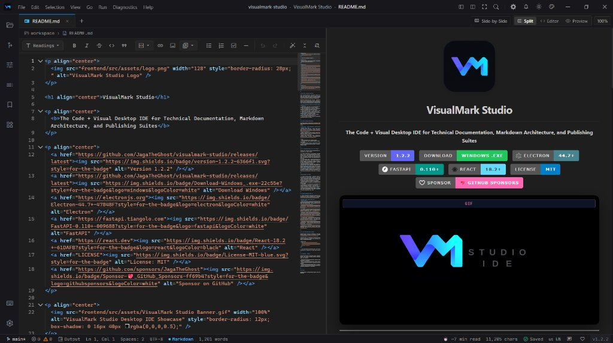
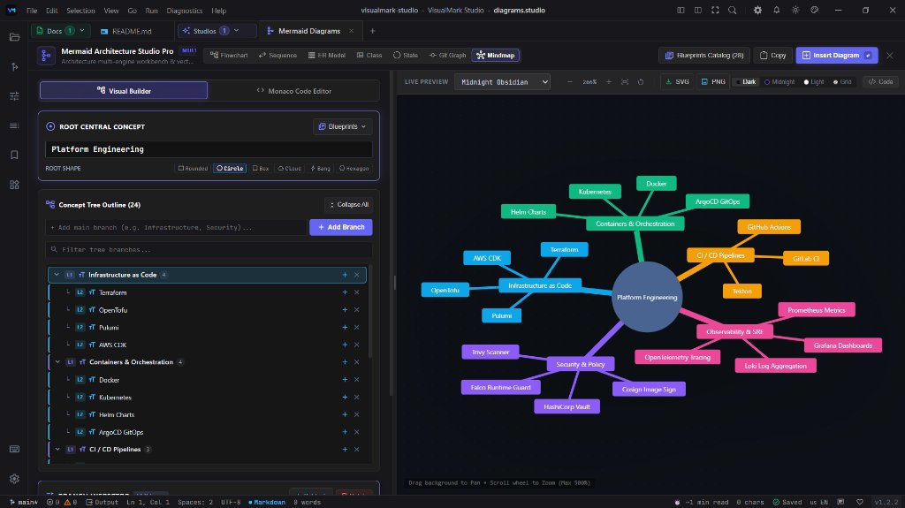
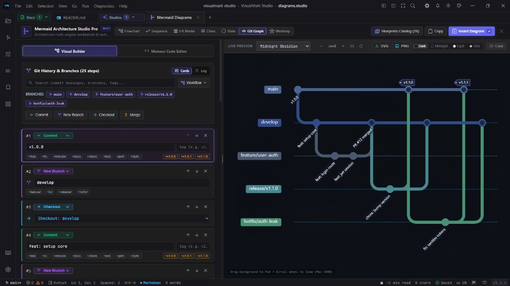
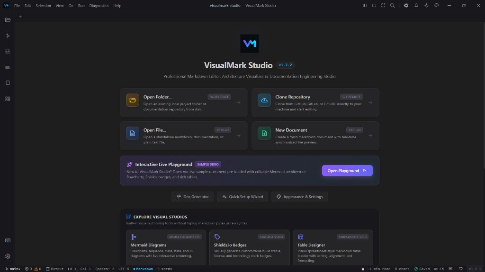
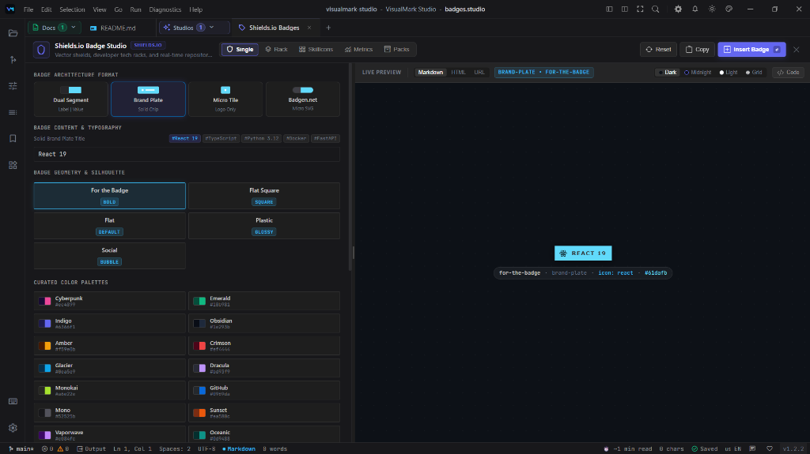

  

<h1 align="center">VisualMark Studio</h1>

  <b>The Code + Visual Desktop IDE for Technical Documentation, Markdown Architecture, and Publishing Suites</b>

  
  
  
  
  
  
  

  

---

## ⚡ The Unified Documentation Experience

Writing technical documentation is notoriously fragmented across disconnected browser tabs: drafting Markdown in basic text boxes, generating badges on web forms, drawing architecture diagrams on third-party whiteboards, building tables in online converters, and manually tracking release notes.

**VisualMark Studio** unites all of this under a dedicated, **local-first desktop IDE**. It pairs the industry-standard **Monaco code editor** (the engine powering VS Code) with **12 specialized interactive visual studios**, direct local disk I/O, rich documentation architecture tools, and automated documentation generation.

| Traditional Documentation Workflow | The VisualMark Studio Experience |
| :--- | :--- |
| ❌ Jumping across 6+ web tabs to build badges, diagrams, and tables | ✅ **12 Integrated Visual Studios** right in the IDE workspace |
| ❌ Generic web textareas with no multi-cursor or formatting | ✅ **Full Monaco Engine** with GFM syntax, multi-cursor, and hotkeys |
| ❌ Manual formatting and hunting for syntax callouts | ✅ **Floating Selection HUD Toolbar** with live headings, callouts, and code fences |
| ❌ Manual copy-pasting into local repositories | ✅ **Direct Local Disk I/O** (`Ctrl+S`, `Ctrl+O`) and real-time File Explorer |
| ❌ Blind guessing whether Markdown structure is complete | ✅ **README Auditor & Linter** with automated health scoring (A+ to F) |
| ❌ Cloud data leakage and external telemetry | ✅ **Local-First & Private** with zero background tracking or telemetry |

---

## 💡 Why a Dedicated IDE instead of a VS Code Extension?

Developers often ask: *"Why download a standalone desktop app when I can install an extension in my existing editor?"*

1. 🎨 **Visual Design Studios vs. Plain Text**: VS Code Markdown extensions only preview raw text and basic syntax. VisualMark Studio provides **12 bespoke interactive visual design studios** (live vector Repo Card designer, visual Devicon Badge builder, spreadsheet table grids, pan/zoom Mermaid architecture canvas, and marketing hero banners) that cannot run cleanly inside generic text editor tabs.
2. 🧰 **Zero Extension Sprawl & Conflict**: Replicating even half of these capabilities in general-purpose editors requires installing and configuring 8+ disparate extensions that conflict over keybindings, themes, webview resources, and command palettes. VisualMark Studio provides a cohesive, zero-config documentation environment out of the box.
3. 🛡️ **Hardened Sandboxed Workspace**: VS Code extensions run with full, unrestricted Node.js system privileges—a frequent target for supply chain attacks. VisualMark Studio strictly confines file operations to your open workspace (`isPathWithinWorkspace`), sanitizes SVG and Markdown outputs with hardened DOMPurify allowlists, and enforces zero background telemetry.
4. 🎯 **Context Separation & Focus**: When you write code, you need linters, compilers, and debuggers. When you write documentation, you need a creative studio tailored for storytelling, visual assets, and high-impact presentation.

---

## ✨ Core Highlights at a Glance

- 🖥️ **Monaco Code Editor Engine** — Multi-cursor editing, bracket matching, line numbers, soft word wrap toggle (`Alt+Z`), and full formatting.
- 🎨 **12 Dedicated Visual Studios** — Shields.io badges, Mermaid diagrams (Flowchart, Sequence, ER, Class, State, Git, Mindmap), spreadsheet tables, SVG repo cards, hero banners, tree generators, and REST APIs.
- 🪄 **Floating Selection HUD Toolbar** — Notion/Word-style contextual quick-actions anchored to highlighted text (Headings, Code Fences, Links, Callouts, Lists).
- ⚡ **Synchronized Split Preview** — Live GFM compilation with proportional scroll synchronization between editor and preview panes.
- 🔒 **100% Local-First & Private** — Direct local disk I/O, zero cloud telemetries or tracking, and sandboxed workspace isolation.
- 📤 **Multi-Format Publishing** — Export directly to atomic disk files, high-res SVG, 4K Retina PNG, GitHub-styled vector **PDF** (`Ctrl+P`), standalone **HTML**, or a complete documentation **ZIP** suite.

---

## 📸 VisualMark Studio in Action

### 1. Monaco Editor Engine & Synchronized Live Preview
Full VS Code-grade Monaco editing with bracket matching, multi-cursor, floating selection HUD toolbar, and real-time proportional split preview.

  

### 2. Mermaid Architecture Studio Pro
Visually compose complex system topologies, mindmaps, state machines, and Git branch lifelines with 8 curated dark/light themes and 1-click vector export.

| 🧠 Visual Mindmaps & Knowledge Trees | 🔀 Git Graph & Branch Lifelines |
| :---: | :---: |
|  |  |

### 3. Integrated Onboarding Hub & Vector Asset Studios
Jump right into pre-configured workspaces, or design production-ready Shields.io badges and Devicon tech stacks without memorizing markdown URLs.

| 🚀 Welcome Hub & Interactive Playground | 🛡️ Shields.io Vector Badge Designer |
| :---: | :---: |
|  |  |

> [!TIP]
> **Crafted for Developers, Architects & Technical Writers**  
> These are just a few of the capabilities built into VisualMark Studio. If you want to ease your technical documentation, visually design architecture diagrams without syntax headaches, or turn plain Markdown into stunning project showcases, **this is the editor built for you.**

---

## 💾 Download VisualMark Studio Desktop

Get started in seconds with pre-compiled, standalone desktop binaries from the latest [GitHub Release](https://github.com/JagaTheGhost/visualmark-studio/releases/latest):

| Operating System | Package | Description | Direct Download |
| :--- | :--- | :--- | :--- |
| **Windows** | `.exe` (NSIS Setup) | Complete desktop installer with Start Menu, Desktop shortcuts, delta auto-updates & Explorer integration | [Download Setup (.exe)](https://github.com/JagaTheGhost/visualmark-studio/releases/latest/download/VisualMark-Studio-Setup.exe) |
| **Linux** | `.AppImage` / `.deb` | Universal AppImage (plug-and-play) & Debian/Ubuntu `.deb` package | [Download Linux Packages](https://github.com/JagaTheGhost/visualmark-studio/releases/latest) |
| **macOS** | `.dmg` (Apple Silicon & Intel) | Drag-and-drop installer for macOS (`arm64` Apple Silicon & `x64` Intel) | [Download macOS DMG](https://github.com/JagaTheGhost/visualmark-studio/releases/latest) |

> [!NOTE]
> **Windows SmartScreen & macOS Gatekeeper Notice**: 
> - **Windows**: Click **More info → Run anyway** if prompted by SmartScreen on initial launch.
> - **macOS**: Right-click the app in `/Applications` → select **Open** (or run `xattr -cr /Applications/VisualMark\ Studio.app` in Terminal) to approve the open-source binary.

---

## 📖 Official Documentation & Wiki Hub

For complete, top-to-bottom documentation, comprehensive studio manuals, architectural deep dives, and shortcuts, visit the **[VisualMark Studio Wiki](https://github.com/JagaTheGhost/visualmark-studio/wiki)**:

| Wiki Guide | Content Covered | Direct Link |
| :--- | :--- | :--- |
| 🎨 **[12 Visual Studios Guide](https://github.com/JagaTheGhost/visualmark-studio/wiki/Visual-Studios)** | In-depth manual for Badges, Diagrams, Tables, Repo Cards, and Banners | [Open Guide ➔](https://github.com/JagaTheGhost/visualmark-studio/wiki/Visual-Studios) |
| 🚀 **[Getting Started](https://github.com/JagaTheGhost/visualmark-studio/wiki/Getting-Started)** | System prerequisites, installation, and local development | [Open Guide ➔](https://github.com/JagaTheGhost/visualmark-studio/wiki/Getting-Started) |
| 🖥️ **[Desktop Architecture](https://github.com/JagaTheGhost/visualmark-studio/wiki/Desktop-Architecture)** | Electron IPC context bridge, dynamic port negotiation & FastAPI sidecar specs | [Open Guide ➔](https://github.com/JagaTheGhost/visualmark-studio/wiki/Desktop-Architecture) |
| ⌨️ **[Keyboard Shortcuts Directory](https://github.com/JagaTheGhost/visualmark-studio/wiki/Home#%EF%B8%8F-common-keyboard-shortcuts)** | Master shortcut reference, command palette hotkeys, and keybinding overrides | [Open Guide ➔](https://github.com/JagaTheGhost/visualmark-studio/wiki/Home#%EF%B8%8F-common-keyboard-shortcuts) |
| 🖌️ **[Design System & Tokens](https://github.com/JagaTheGhost/visualmark-studio/wiki/Design-System)** | Dark Obsidian palette, typography, glassmorphism tokens, and UI guidelines | [Open Guide ➔](https://github.com/JagaTheGhost/visualmark-studio/wiki/Design-System) |
| 📦 **[Packaging & Deployment](https://github.com/JagaTheGhost/visualmark-studio/wiki/Deployment)** | Building standalone installers (.exe, .dmg, .AppImage) with Electron-Builder | [Open Guide ➔](https://github.com/JagaTheGhost/visualmark-studio/wiki/Deployment) |
| 🧪 **[Testing & QA Guide](https://github.com/JagaTheGhost/visualmark-studio/wiki/Testing-Guide)** | Pytest test automation suites, frontend Vite builds, and QA checklist | [Open Guide ➔](https://github.com/JagaTheGhost/visualmark-studio/wiki/Testing-Guide) |

---

## 💖 Support Development (GitHub Sponsors)

VisualMark Studio is **100% free, local-first, and open source** with zero tracking, telemetry, or paywalls. It is engineered and maintained independently by [**@JagaTheGhost**](https://github.com/JagaTheGhost).

If VisualMark Studio has accelerated your technical workflows, polished your repository presentations, or simplified your architecture diagrams, consider backing its continued development:

  

> ☕ *Your support helps keep maintenance active, keeps all studios ad-free, and directly funds the development of new visual diagram engines and templates.*

---

## 🤝 Contributing & Community

VisualMark Studio thrives on open-source community contributions! Whether you're reporting a bug, proposing a new visual studio, or polishing documentation, we welcome your involvement.

- **[Contributing Guide](CONTRIBUTING.md)**: Development setup, branch conventions, and PR workflow.
- **[Code of Conduct](CODE_OF_CONDUCT.md)**: Community standards and pledge.
- **[Security Policy](SECURITY.md)**: Vulnerability disclosure and reporting guidelines.
- **[Changelog](CHANGELOG.md)**: Release history and version notes.
- **[Official Wiki](https://github.com/JagaTheGhost/visualmark-studio/wiki)**: Comprehensive architectural and user manuals.

---

## 📄 License

VisualMark Studio is open-source software licensed under the **[MIT License](LICENSE)**.
